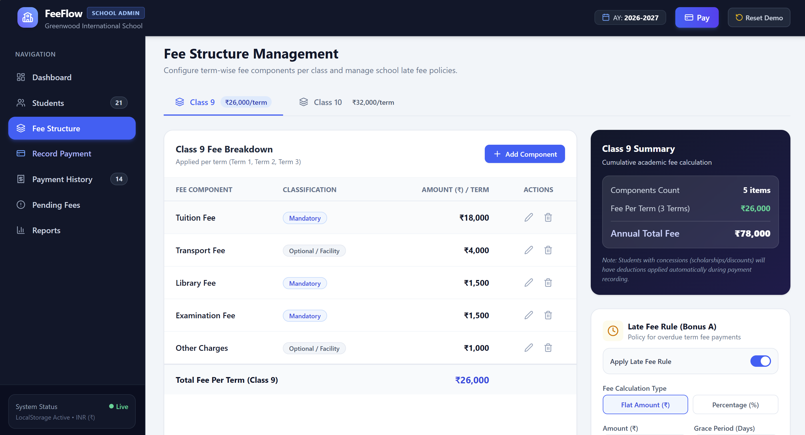
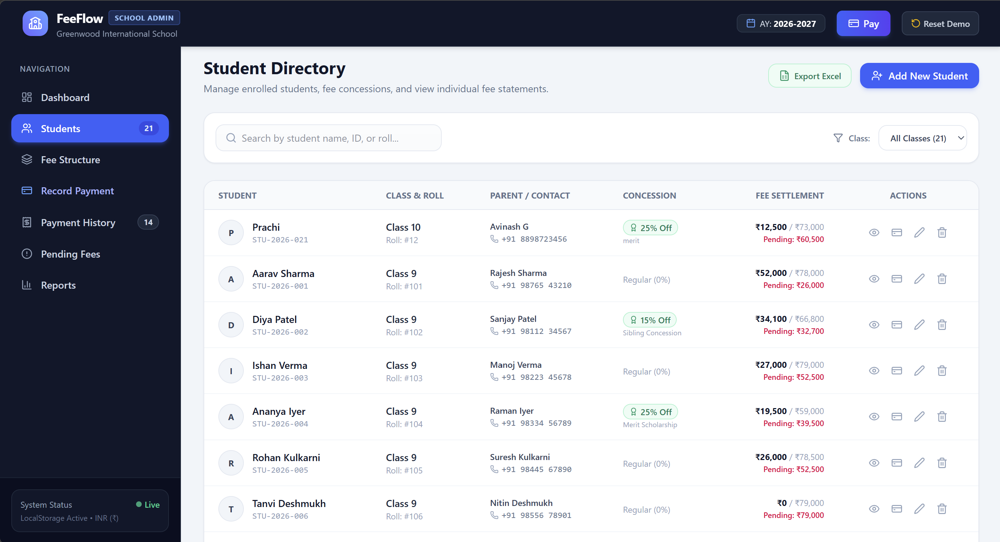
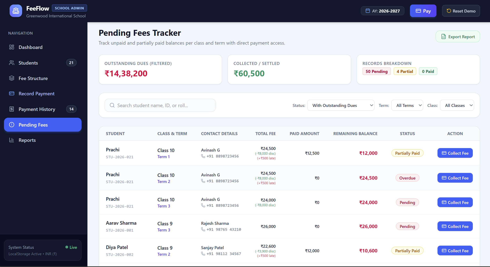

# FeeFlow – Fee Management System & Receipt Generator

A frontend-based school fee administration web application built using **React, Vite, Tailwind CSS, and LocalStorage**. FeeFlow helps school administrators manage class-wise fee structures, record student payments across academic terms, generate printable receipts, track pending fees, and analyze fee collection through an interactive dashboard.

---

## 1. Project Description

**FeeFlow** is a school fee management application designed to simplify and automate fee administration. It replaces manual spreadsheet-based tracking with a centralized dashboard that manages fee obligations per class, per student, and per academic term.

The system supports partial payments, student concessions, late fees, automatic receipt generation, pending fee tracking, and Excel report exports.

## 2. Technologies Used

- **Frontend Framework:** React 19
- **Build Tool:** Vite
- **Programming Language:** JavaScript
- **Styling:** Tailwind CSS
- **Data Persistence:** Browser LocalStorage
- **Icon Library:** Lucide React
- **Data Visualization:** Recharts
- **Excel Export:** SheetJS (xlsx)

## 3. Features Implemented

### Mandatory Features

| No. | Feature | Implementation |
|---|---|---|
| 1 | Fee Structure Per Class | Configurable fee structures for Class 9 and Class 10, including tuition, transport, library, examination, and other charges. |
| 2 | Record Payments | Record payments for individual students across Term 1, Term 2, and Term 3. Supports partial payments and multiple payment modes. |
| 3 | Automatic Receipt Generation | Generates unique sequential receipt numbers and printable receipts containing student and payment details. |
| 4 | Pending Fee List | Displays outstanding balances by class and term, with student search and payment status filters. |
| 5 | Collection Summary Dashboard | Displays total students, expected fees, collected fees, pending fees, collection percentage, and visual analytics. |

### Bonus Features

| No. | Feature | Implementation |
|---|---|---|
| A | Late Fee Rules | Configurable late fee policies using flat amounts or percentages and grace periods. |
| B | Student Fee Concessions | Supports student-specific concession percentages for scholarships and discounts. |
| C | Excel Export | Exports payment history, pending fee reports, student directory, and financial reports to Excel. |

---

## 4. Application Screenshots

### 4.1 Dashboard

Displays the overall fee collection summary, including total students, expected fees, collected fees, pending fees, collection percentage, and charts.


### 4.2 Fee Structure

Displays class-wise fee components and allows administrators to manage fee configurations.



### 4.3 Student Management

Displays the student directory with student IDs, class details, roll numbers, and concession information.



### 4.4 Payment Receipt

Displays the automatically generated receipt after recording a student's payment, including the fee breakdown, concession, late fee, amount paid, and remaining balance.


### 4.5 Pending Fees

Displays outstanding student fees, organized by class and academic term.



---

## 5. Installation Instructions

### Prerequisites

- Node.js v18 or higher
- npm v9 or higher

### Steps

1. Clone the repository:

   ```bash
   git clone YOUR_GITHUB_REPOSITORY_URL
   ```

2. Navigate to the project directory:

   ```bash
   cd "fee management & receipt generator"
   ```

3. Install dependencies:

   ```bash
   npm install
   ```

4. Start the development server:

   ```bash
   npm run dev
   ```

5. Open the local URL displayed in the terminal, typically:

   ```text
   http://localhost:5173
   ```

## 6. Commands Reference

| Command | Description |
|---|---|
| `npm run dev` | Starts the development server. |
| `npm run build` | Creates an optimized production build. |
| `npm run preview` | Previews the production build locally. |
| `node scripts/testScenarios.js` | Runs the automated test scenarios. |

## 7. Data Model Architecture

The application state is managed centrally using React Context API through `FeeContext` and persisted using browser LocalStorage.

### Main Entities

**1. Student**
- Student ID
- Student name
- Class ID
- Roll number
- Parent name
- Contact number
- Concession percentage
- Concession reason

**2. Fee Component**
- Component ID
- Component name
- Amount
- Mandatory status

**3. Academic Term**
- Term ID
- Term name
- Due date

**4. Payment Transaction**
- Receipt number
- Student ID
- Class ID
- Term ID
- Payment amount
- Base fee
- Concession amount
- Late fee
- Previous payment
- Remaining balance
- Payment mode
- Transaction reference

### Data Relationships

- Each student belongs to a particular class.
- Each class has a configurable fee structure.
- Each academic term has a fee due date.
- Each payment is associated with a student and academic term.
- Multiple payments can be recorded for the same student and term.

## 8. Validation and Business Logic

### 8.1 Fee Calculation

The effective payable amount is calculated as:

**Payable Amount = Base Fee − Concession Amount + Applicable Late Fee**

**Outstanding Balance = Payable Amount − Previously Paid Amount**

### 8.2 Payment Validation

- Payments must be greater than zero.
- Payments cannot exceed the outstanding balance.
- Duplicate student IDs are prevented.
- Students with existing payment history are protected against accidental deletion.

### 8.3 Automatic Receipt Numbers

Each successful payment generates a unique sequential receipt number in the format:

`FEE-2026-0001`

`FEE-2026-0002`

### 8.4 Payment Status

- **Paid:** No outstanding balance.
- **Partially Paid:** Some amount has been paid, but a balance remains.
- **Pending:** No payment has been made.
- **Overdue:** Outstanding fees remain after the applicable due date and grace period.

### 8.5 Receipt Printing

The receipt uses a dedicated print layout so that unnecessary navigation elements and buttons are excluded when printing.

## 9. AI Tools Used

The following AI tools were used during development:

- **Google Antigravity:** Used to assist with application scaffolding, component generation, UI development, implementation of application features, and debugging.
- **ChatGPT:** Used for requirement analysis, prompt preparation, understanding implementation details, troubleshooting, testing guidance, and README documentation.

AI-generated code and suggestions were reviewed and tested during implementation.

## 10. AI Prompts Used During Development

Examples of prompts used:

1. "Act as a senior full-stack developer and UI/UX designer. Build a complete school fee administration web app called FeeFlow using React, Vite, Tailwind CSS, Lucide React, Recharts, and LocalStorage."

2. "Architect a modular financial calculation helper that computes base fees, concessions, partial payments, late fees, and remaining balances per student per term."

3. "Create a printable school fee receipt with student details, financial breakdown, amount in words, and print-specific styling."

4. "Implement Excel export utilities for payment histories, pending fee lists, student directories, and financial reports."

## 11. Limitations and Future Scope

### Limitations

- **Client-Side Storage:** Data is currently stored in browser LocalStorage and is not shared across different devices.
- **Single Currency:** The application is currently designed for Indian Rupees (₹).
- **No Backend:** The application does not currently use a centralized database or server-side authentication.

### Future Enhancements

- Integration with a backend and database such as PostgreSQL.
- User authentication and role-based access.
- Online payment gateway integration.
- Automated SMS, email, or WhatsApp receipt delivery.
- Multi-school and multi-campus support.

---

## 12. Conclusion

FeeFlow provides a simple and organized approach to school fee administration by combining fee structure management, student payment tracking, automatic receipt generation, pending fee monitoring, and collection analytics in one application.

The project demonstrates the practical use of React, component-based architecture, data modelling, validation, financial calculations, and reporting.

**FeeFlow – Simplifying School Fee Management.**